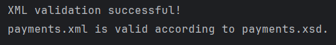
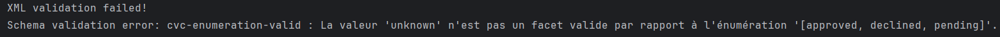
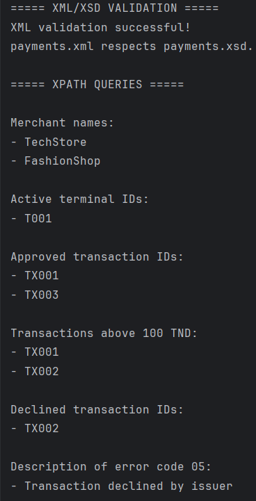
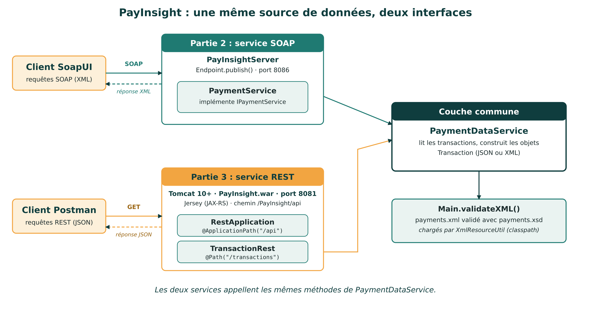
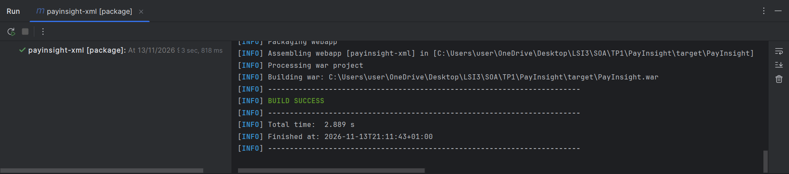
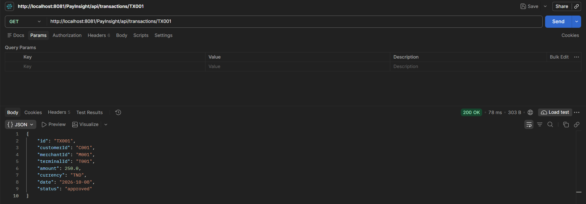
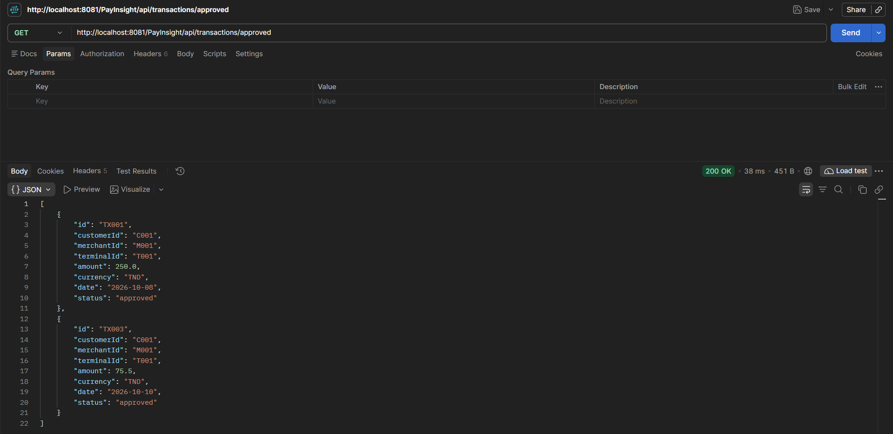
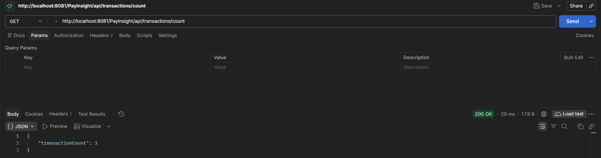
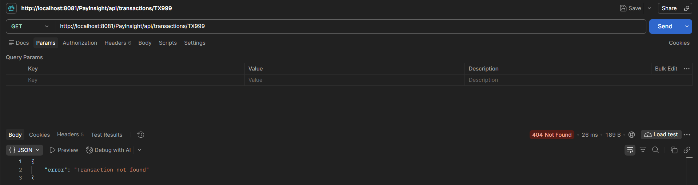
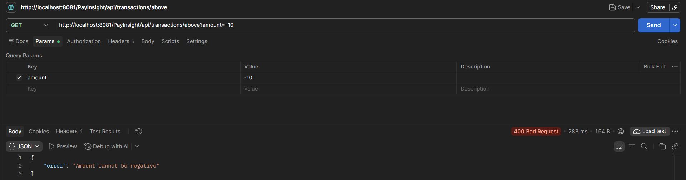

# PayInsight

### Système de gestion des paiements avec XML, XSD, XPath et services web SOAP et REST

Projet académique de développement Java autour de XML, XSD, XPath et des services web SOAP et REST.

---

## Table des matières

1. [Présentation du projet](#1-présentation-du-projet)
2. [Objectifs pédagogiques](#2-objectifs-pédagogiques)
3. [Technologies utilisées](#3-technologies-utilisées)
4. [Structure du projet](#4-structure-du-projet)
5. [Partie 1 — Les données (XML, XSD et XPath)](#5-partie-1--les-données-xml-xsd-et-xpath)
6. [Partie 2 — Le service web SOAP](#6-partie-2--le-service-web-soap)
7. [Partie 3 — Le service REST](#7-partie-3--le-service-rest)
8. [Exécution du projet](#8-exécution-du-projet)
9. [Limites et perspectives](#9-limites-et-perspectives)
10. [Conclusion](#10-conclusion)
11. [Avertissement](#11-avertissement)

---

## 1. Présentation du projet

**PayInsight** est une application Java qui modélise un système de paiement simplifié. Elle permet de gérer des informations relatives aux clients, commerçants, terminaux de paiement, transactions et codes d'erreur.

Le projet est construit en trois parties qui s'enchaînent :

* **Partie 1 — Les données :** modélisation en XML, définition d'un schéma XSD, validation du document en Java avec JAXP et interrogation des données avec XPath.
* **Partie 2 — Le service web SOAP :** un service développé avec JAX-WS, qui permet d'accéder à ces mêmes données à distance.
* **Partie 3 — Le service REST :** un service développé avec JAX-RS (Jersey), déployé sous forme de WAR sur Tomcat, qui expose les mêmes données en JSON.

L'idée est simple : la partie 1 prépare des données fiables, les parties 2 et 3 les mettent à disposition de clients externes avec deux styles de services différents. L'objectif principal est de montrer comment plusieurs technologies peuvent fonctionner ensemble dans une même application.

**Lien entre les parties :** le service SOAP (partie 2) et le service REST (partie 3) réutilisent tous les deux le document XML, le schéma XSD, la méthode de validation et la classe d'accès aux données de la partie 1. Il ne s'agit donc pas de trois applications indépendantes, mais d'un seul projet.

---

## 2. Objectifs pédagogiques

| Partie | Objectifs                                                                                                                         |
| ------ | --------------------------------------------------------------------------------------------------------------------------------- |
| 1 | Modéliser un domaine réel en XML, créer un schéma XSD, valider un document XML et interroger ses données avec XPath.              |
| 2 | Développer un service web SOAP avec JAX-WS, publier le service, consulter son WSDL et tester ses opérations avec SoapUI et JUnit. |
| 3 | Développer un service web REST avec JAX-RS (Jersey), le déployer sous forme de WAR sur Tomcat et tester ses ressources avec Postman. |

À travers ce projet, nous avons travaillé sur la structuration, la validation, l'exploitation et l'exposition de données à l'aide de différentes technologies Java, XML et web.

---

## 3. Technologies utilisées

| Technologie / Outil | Rôle                                                |
| ------------------- | --------------------------------------------------- |
| Java                | Langage de programmation                            |
| JAXP                | Validation XML/XSD et traitement XPath              |
| XML                 | Représentation des données de paiement              |
| XSD                 | Définition et validation de la structure XML        |
| XPath               | Recherche et extraction des données XML             |
| Maven               | Gestion du projet et des dépendances                |
| SOAP                | Protocole d'échange de messages XML                 |
| JAX-WS              | Développement du service web SOAP                   |
| JAXB                | Conversion entre objets Java et représentations XML |
| JAX-RS (Jakarta REST) | Spécification des services web REST               |
| Jersey              | Implémentation de JAX-RS                            |
| Jackson             | Conversion des objets Java en JSON                  |
| Tomcat              | Serveur d'applications (déploiement du WAR)         |
| Postman             | Test des ressources REST                            |
| JUnit 4             | Tests unitaires                                     |
| SoapUI              | Test des opérations SOAP                            |
| IntelliJ IDEA       | Environnement de développement                      |
| Git et GitHub       | Gestion de versions et hébergement du projet        |

### Dépendances Maven principales

| Dépendance                                  | Version | Partie | Rôle                                           |
| ------------------------------------------- | ------- | ------ | ---------------------------------------------- |
| JUnit (`junit`)                             | 4.13.2  | 1 et 2 | Tests unitaires                                |
| `jakarta.xml.ws-api`                        | 2.3.3   | 2      | API des services web SOAP                      |
| JAX-WS Runtime (`jaxws-rt`)                 | 2.3.7   | 2      | Exécution du service SOAP                      |
| `javax.jws-api`                             | 1.1     | 2      | Annotations des services web SOAP              |
| `jakarta.ws.rs-api`                         | 3.1.0   | 3      | API Jakarta REST (JAX-RS)                      |
| `jersey-container-servlet`                  | 3.1.10  | 3      | Intégration de Jersey dans un conteneur de servlets |
| `jersey-hk2`                                | 3.1.10  | 3      | Injection de dépendances de Jersey             |
| `jersey-media-json-jackson`                 | 3.1.10  | 3      | Conversion des objets Java en JSON             |
| `jakarta.xml.bind-api`                      | 4.0.2   | 3      | API JAXB requise par Jersey 3                  |
| `jakarta.activation-api`                    | 2.1.3   | 3      | API Activation requise par Jersey 3            |
| `javax.xml.bind:jaxb-api`                   | 2.3.1   | 2      | JAXB « legacy » conservé pour le service SOAP  |
| `javax.activation-api`                      | 1.2.0   | 2      | Activation « legacy » conservé pour le service SOAP |

Le projet est compilé en Java 11 (`release 11`) avec l'encodage UTF-8. Son packaging est `war` et l'archive générée s'appelle `PayInsight.war` (`finalName`).

> **Remarque sur les packages :** les deux services web n'utilisent pas le même espace de noms.
>
> * Le service **SOAP** (partie 2) utilise les anciens packages `javax.*` (par exemple `javax.xml.ws.Endpoint`, `javax.jws.WebService`), même si la dépendance s'appelle `jakarta.xml.ws-api` : la version 2.3.3 utilise encore `javax.*`.
> * Le service **REST** (partie 3) utilise les packages `jakarta.*` (par exemple `jakarta.ws.rs.Path`), car Jersey 3 et Jakarta REST 3.1 sont basés sur Jakarta EE 9 ou supérieur.
>
> C'est pourquoi le `pom.xml` contient à la fois les bibliothèques JAXB et Activation en version `javax` (pour SOAP) et en version `jakarta` (pour REST).

---

## 4. Structure du projet

```text
PayInsight/
│
├── pom.xml
├── README.md
├── .gitignore
│
├── images/
│   ├── validation-success.png
│   ├── validation-error.png
│   ├── xpath-results.png
│   ├── cycle-de-vie-ws.png
│   ├── diagramme-classes.png
│   ├── structure-wsdl.png
│   ├── message-soap.png
│   ├── sequence-gettransaction.png
│   ├── soap-get-transaction.png
│   ├── soap-approved-transactions.png
│   ├── soap-transactions-above-amount.png
│   ├── soap-transaction-count.png
│   ├── junit-tests.png
│   ├── rest-architecture.png
│   ├── maven-package-war.png
│   ├── rest-get-transaction.png
│   ├── rest-approved-transactions.png
│   ├── rest-transactions-above-amount.png
│   ├── rest-transaction-count.png
│   ├── rest-transaction-not-found.png
│   └── rest-negative-amount.png
│
└── src/
    ├── main/
    │   ├── java/com/payinsight/
    │   │   ├── Main.java
    │   │   │
    │   │   ├── data/
    │   │   │   ├── Transaction.java
    │   │   │   ├── PaymentDataService.java
    │   │   │   └── XmlResourceUtil.java
    │   │   │
    │   │   ├── service/
    │   │   │   ├── IPaymentService.java
    │   │   │   └── PaymentService.java
    │   │   │
    │   │   ├── server/
    │   │   │   └── PayInsightServer.java
    │   │   │
    │   │   └── rest/
    │   │       ├── RestApplication.java
    │   │       └── TransactionRest.java
    │   │
    │   └── resources/
    │       └── data/
    │           ├── payments.xml
    │           └── payments.xsd
    │
    └── test/
        └── java/com/payinsight/
            └── PayInsightTest.java
```

Les fichiers `payments.xml` et `payments.xsd` se trouvent dans `src/main/resources/data` afin d'être empaquetés dans le WAR. La classe `XmlResourceUtil` les charge depuis le classpath de l'application (et, à défaut, depuis le système de fichiers).

### Rôle des principaux fichiers

| Fichier                   | Responsabilité                                             |
| ------------------------- | ---------------------------------------------------------- |
| `payments.xml`            | Contient les données du système de paiement                |
| `payments.xsd`            | Définit les règles de structure et de validation du XML    |
| `Main.java`               | Valide le XML (partie 1) et exécute les requêtes XPath          |
| `Transaction.java`        | Représente une transaction sous forme d'objet Java (JAXB)  |
| `PaymentDataService.java` | Valide puis lit `payments.xml` et construit les objets     |
| `IPaymentService.java`    | Définit le contrat et les opérations du service SOAP       |
| `PaymentService.java`     | Implémente les opérations et contrôle les paramètres       |
| `PayInsightServer.java`   | Publie le service SOAP                                     |
| `XmlResourceUtil.java`    | Charge `payments.xml` et `payments.xsd` (classpath, puis fichier) |
| `RestApplication.java`    | Déclare l'application REST et son chemin de base `/api`    |
| `TransactionRest.java`    | Expose les ressources REST sur les transactions            |
| `PayInsightTest.java`     | Contient les tests unitaires JUnit                         |
| `pom.xml`                 | Configure Maven et les dépendances                         |

---

# 5. Partie 1 — Les données (XML, XSD et XPath)

Cette première partie construit la base de tout le projet : des données de paiement bien structurées, vérifiées automatiquement et faciles à interroger.

## 5.1 Modélisation des données

Le fichier `payments.xml` représente les données du système de paiement.

Il possède un élément racine nommé `paymentSystem`, qui contient cinq sections principales.

| Section        | Description                                | Exemple                            |
| -------------- | ------------------------------------------ | ---------------------------------- |
| `customers`    | Informations sur les clients               | C001, Ahmed Ben Ali                |
| `merchants`    | Informations sur les commerçants           | M001, TechStore                    |
| `terminals`    | Informations sur les terminaux de paiement | T001, Sfax                         |
| `transactions` | Informations sur les transactions          | TX001, 250.00 TND                  |
| `errorCodes`   | Codes et descriptions des erreurs          | 05, Transaction declined by issuer |

Les transactions utilisent des identifiants pour référencer les clients, les commerçants et les terminaux concernés.

La devise utilisée dans les transactions est le dinar tunisien (TND).

### Données utilisées

Le projet utilise des données fictives.

**Clients**

| Identifiant | Nom           | E-mail             | Pays    |
| ----------- | ------------- | ------------------ | ------- |
| C001        | Ahmed Ben Ali | ahmed@example.com  | Tunisia |
| C002        | Sarah Mansour | sarah@example.com  | Tunisia |

**Commerçants**

| Identifiant | Nom         | Catégorie   | Pays    |
| ----------- | ----------- | ----------- | ------- |
| M001        | TechStore   | Electronics | Tunisia |
| M002        | FashionShop | Clothing    | Tunisia |

**Terminaux**

| Identifiant | Commerçant | Localisation | Statut   |
| ----------- | ---------- | ------------ | -------- |
| T001        | M001       | Sfax         | active   |
| T002        | M002       | Tunis        | inactive |

**Transactions**

| Identifiant | Client | Commerçant | Terminal | Montant (TND) | Date       | Statut   |
| ----------- | ------ | ---------- | -------- | ------------: | ---------- | -------- |
| TX001       | C001   | M001       | T001     |        250.00 | 2026-10-08 | approved |
| TX002       | C002   | M002       | T002     |        120.00 | 2026-10-09 | declined |
| TX003       | C001   | M001       | T001     |         75.50 | 2026-10-10 | approved |

**Codes d'erreur**

| Code | Description                    | Gravité |
| ---- | ------------------------------ | ------- |
| 05   | Transaction declined by issuer | medium  |
| 51   | Insufficient funds             | medium  |
| 96   | System malfunction             | high    |

### Exemple de structure XML

```xml
<paymentSystem>
    <customers>
        <customer id="C001">
            <name>Ahmed Ben Ali</name>
            <email>ahmed@example.com</email>
            <country>Tunisia</country>
        </customer>
    </customers>

    <merchants>
        ...
    </merchants>

    <terminals>
        ...
    </terminals>

    <transactions>
        ...
    </transactions>

    <errorCodes>
        ...
    </errorCodes>
</paymentSystem>
```

## 5.2 Définition du schéma XSD

Le fichier `payments.xsd` définit les règles que le document XML doit respecter.

Il permet notamment de contrôler :

* La structure et l'ordre des éléments.
* Les types de données.
* Les attributs obligatoires.
* Les identifiants et leurs références.
* Les valeurs autorisées pour les statuts et les niveaux de gravité.

### Principales constructions XSD utilisées

| Construction     | Rôle                                         |
| ---------------- | -------------------------------------------- |
| `xs:element`     | Déclaration d'un élément XML                 |
| `xs:attribute`   | Déclaration d'un attribut                    |
| `xs:complexType` | Définition d'une structure complexe          |
| `xs:simpleType`  | Définition d'un type simple                  |
| `xs:sequence`    | Imposition d'un ordre aux éléments           |
| `xs:ID`          | Déclaration d'un identifiant unique          |
| `xs:IDREF`       | Référence vers un identifiant existant       |
| `xs:restriction` | Restriction des valeurs autorisées           |
| `xs:enumeration` | Définition d'une liste de valeurs autorisées |
| `maxOccurs`      | Définition du nombre maximal d'occurrences   |

### Exemple : structure globale

Dans le fichier XML :

```xml
<paymentSystem>
    <customers>
        <customer id="C001"> ... </customer>
    </customers>
    <merchants> ... </merchants>
    <terminals> ... </terminals>
    <transactions> ... </transactions>
    <errorCodes> ... </errorCodes>
</paymentSystem>
```

Dans le fichier XSD :

```xml
<xs:element name="paymentSystem">
    <xs:complexType>
        <xs:sequence>
            <xs:element name="customers">
                <xs:complexType>
                    <xs:sequence>
                        <xs:element name="customer"
                                    type="CustomerType"
                                    maxOccurs="unbounded"/>
                    </xs:sequence>
                </xs:complexType>
            </xs:element>

            <!-- merchants, terminals, transactions, errorCodes :
                 même principe -->
        </xs:sequence>
    </xs:complexType>
</xs:element>
```

`xs:sequence` impose l'ordre des cinq sections. `maxOccurs="unbounded"` autorise plusieurs éléments dans une section.

### Exemple : définition d'un client

Dans le fichier XML :

```xml
<customer id="C001">
    <name>Ahmed Ben Ali</name>
    <email>ahmed@example.com</email>
    <country>Tunisia</country>
</customer>
```

Dans le fichier XSD :

```xml
<xs:complexType name="CustomerType">
    <xs:sequence>
        <xs:element name="name" type="xs:string"/>
        <xs:element name="email" type="xs:string"/>
        <xs:element name="country" type="xs:string"/>
    </xs:sequence>

    <xs:attribute name="id" type="xs:ID" use="required"/>
</xs:complexType>
```

L'attribut `id` est obligatoire et doit être unique dans le document.

### Exemple : définition d'un commerçant

Dans le fichier XML :

```xml
<merchant id="M001">
    <name>TechStore</name>
    <category>Electronics</category>
    <country>Tunisia</country>
</merchant>
```

Dans le fichier XSD :

```xml
<xs:complexType name="MerchantType">
    <xs:sequence>
        <xs:element name="name" type="xs:string"/>
        <xs:element name="category" type="xs:string"/>
        <xs:element name="country" type="xs:string"/>
    </xs:sequence>

    <xs:attribute name="id" type="xs:ID" use="required"/>
</xs:complexType>
```

L'identifiant du commerçant est déclaré comme un `xs:ID`, ce qui garantit son unicité dans le document XML.

### Exemple : définition d'un terminal

Dans le fichier XML :

```xml
<terminal id="T001">
    <merchantId>M001</merchantId>
    <location>Sfax</location>
    <status>active</status>
</terminal>
```

Dans le fichier XSD :

```xml
<xs:complexType name="TerminalType">
    <xs:sequence>
        <xs:element name="merchantId" type="xs:IDREF"/>
        <xs:element name="location" type="xs:string"/>

        <xs:element name="status">
            <xs:simpleType>
                <xs:restriction base="xs:string">
                    <xs:enumeration value="active"/>
                    <xs:enumeration value="inactive"/>
                </xs:restriction>
            </xs:simpleType>
        </xs:element>
    </xs:sequence>

    <xs:attribute name="id" type="xs:ID" use="required"/>
</xs:complexType>
```

`merchantId` est de type `xs:IDREF` : sa valeur (`M001`) doit correspondre à un identifiant existant dans le document XML.

Le statut du terminal est limité à deux valeurs : `active` et `inactive`.

### Exemple : définition d'une transaction

Dans le fichier XML :

```xml
<transaction id="TX001">
    <customerId>C001</customerId>
    <merchantId>M001</merchantId>
    <terminalId>T001</terminalId>
    <amount currency="TND">250.00</amount>
    <date>2026-10-08</date>
    <status>approved</status>
</transaction>
```

Dans le fichier XSD :

```xml
<xs:complexType name="TransactionType">
    <xs:sequence>
        <xs:element name="customerId" type="xs:IDREF"/>
        <xs:element name="merchantId" type="xs:IDREF"/>
        <xs:element name="terminalId" type="xs:IDREF"/>

        <xs:element name="amount">
            <xs:complexType>
                <xs:simpleContent>
                    <xs:extension base="xs:decimal">
                        <xs:attribute name="currency"
                                      type="xs:string"
                                      use="required"/>
                    </xs:extension>
                </xs:simpleContent>
            </xs:complexType>
        </xs:element>

        <xs:element name="date" type="xs:date"/>

        <xs:element name="status">
            <xs:simpleType>
                <xs:restriction base="xs:string">
                    <xs:enumeration value="approved"/>
                    <xs:enumeration value="declined"/>
                    <xs:enumeration value="pending"/>
                </xs:restriction>
            </xs:simpleType>
        </xs:element>
    </xs:sequence>

    <xs:attribute name="id" type="xs:ID" use="required"/>
</xs:complexType>
```

Les références `customerId`, `merchantId` et `terminalId` sont de type `xs:IDREF`.

Le montant utilise `xs:decimal`, tandis que l'attribut `currency` est obligatoire. Le statut est limité à trois valeurs : `approved`, `declined` et `pending`.

**Correspondance XML / XSD pour une transaction**

| Dans le XML                                          | Dans le XSD                                                           |
| ---------------------------------------------------- | --------------------------------------------------------------------- |
| `id="TX001"`                                         | `xs:attribute` de type `xs:ID`, obligatoire                           |
| `<customerId>C001</customerId>` et autres références | `xs:element` de type `xs:IDREF`                                       |
| `250.00`                                             | `xs:decimal`                                                          |
| `currency="TND"`                                     | Attribut obligatoire défini avec `xs:simpleContent` et `xs:extension` |
| `2026-10-08`                                         | `xs:date`                                                             |
| `approved`, `declined`, `pending`                    | Valeurs autorisées avec `xs:restriction` et `xs:enumeration`          |

### Exemple : définition d'un code d'erreur

Dans le fichier XML :

```xml
<error code="05">
    <description>Transaction declined by issuer</description>
    <severity>medium</severity>
</error>
```

Dans le fichier XSD :

```xml
<xs:complexType name="ErrorType">
    <xs:sequence>
        <xs:element name="description" type="xs:string"/>

        <xs:element name="severity">
            <xs:simpleType>
                <xs:restriction base="xs:string">
                    <xs:enumeration value="low"/>
                    <xs:enumeration value="medium"/>
                    <xs:enumeration value="high"/>
                </xs:restriction>
            </xs:simpleType>
        </xs:element>
    </xs:sequence>

    <xs:attribute name="code" type="xs:string" use="required"/>
</xs:complexType>
```

Ici, `code` est un attribut obligatoire de type `xs:string`, et non un `xs:ID`.

Le niveau de gravité est limité à trois valeurs : `low`, `medium` et `high`.

### Récapitulatif XML ↔ XSD

| Dans `payments.xml`                       | Dans `payments.xsd`                                |
| ----------------------------------------- | -------------------------------------------------- |
| Attribut `id="C001"`                      | `xs:attribute` de type `xs:ID`, obligatoire        |
| Référence `<customerId>C001</customerId>` | `xs:element` de type `xs:IDREF`                    |
| Texte (nom, e-mail, lieu, description)    | `xs:string`                                        |
| Montant `250.00`                          | `xs:decimal`, avec attribut `currency` obligatoire |
| Date `2026-10-08`                         | `xs:date`                                          |
| Valeurs limitées (statuts, gravité)       | `xs:restriction` et `xs:enumeration`               |
| Plusieurs éléments dans une section       | `maxOccurs="unbounded"`                            |
| Ordre des éléments                        | `xs:sequence`                                      |

## 5.3 Validation XML/XSD avec Java

La validation est réalisée dans `Main.java`, à l'aide des classes de JAXP :

* `SchemaFactory`
* `Schema`
* `Validator`
* `StreamSource`

Le processus de validation est le suivant :

1. Création d'une fabrique de schémas avec `SchemaFactory`.
2. Chargement du fichier `payments.xsd`.
3. Création d'un objet `Validator`.
4. Validation du fichier `payments.xml`.

La méthode `validateXML()` retourne `true` si le document respecte le schéma XSD.

Les requêtes XPath sont exécutées uniquement après une validation réussie.

### Résultat d'une validation réussie



### Test avec un document XML invalide

Pour vérifier le fonctionnement du mécanisme, le statut de la transaction `TX001` a été remplacé temporairement par `unknown`.

Cette valeur n'est pas autorisée par le schéma XSD. La validation échoue donc (erreur `cvc-enumeration-valid`).

Après ce test, la valeur correcte est restaurée.



## 5.4 Interrogation des données avec XPath

XPath permet de sélectionner des éléments et des attributs dans un document XML à partir d'expressions.

Dans `Main.java`, le traitement utilise notamment :

* `DocumentBuilder` pour charger le document XML.
* `XPathFactory` pour créer un moteur XPath.
* `XPathExpression` pour compiler les expressions.
* `NodeList` pour parcourir les résultats.

### Requêtes XPath réalisées

| N° | Objectif                                       | Expression XPath                                                 | Résultat                       |
| -- | ---------------------------------------------- | ---------------------------------------------------------------- | ------------------------------ |
| 1  | Récupérer les noms des commerçants             | `/paymentSystem/merchants/merchant/name`                         | TechStore, FashionShop         |
| 2  | Récupérer les terminaux actifs                 | `/paymentSystem/terminals/terminal[status='active']/@id`         | T001                           |
| 3  | Récupérer les transactions approuvées          | `/paymentSystem/transactions/transaction[status='approved']/@id` | TX001, TX003                   |
| 4  | Trouver les transactions supérieures à 100 TND | `/paymentSystem/transactions/transaction[amount > 100]/@id`      | TX001, TX002                   |
| 5  | Récupérer les transactions refusées            | `/paymentSystem/transactions/transaction[status='declined']/@id` | TX002                          |
| 6  | Récupérer la description de l'erreur 05        | `/paymentSystem/errorCodes/error[@code='05']/description`        | Transaction declined by issuer |

### Exemple d'analyse d'une expression XPath

Expression :

```xpath
/paymentSystem/transactions/transaction[status='approved']/@id
```

| Partie                | Signification                        | Dans `payments.xml`           |
| --------------------- | ------------------------------------ | ----------------------------- |
| `/paymentSystem`      | Sélectionne l'élément racine         | `<paymentSystem>`             |
| `/transactions`       | Accède à la section des transactions | `<transactions>`              |
| `/transaction`        | Sélectionne les transactions         | `<transaction id="TX001">`    |
| `[status='approved']` | Filtre les transactions approuvées   | `<status>approved</status>`   |
| `/@id`                | Récupère leurs identifiants          | `id="TX001"`                  |

Il faut remarquer que `status` est un élément enfant et non un attribut. C'est pourquoi on utilise `[status='approved']` et non `[@status='approved']`.

### Résultats des requêtes XPath



---

# 6. Partie 2 — Le service web SOAP

Les données de la partie 1 sont désormais structurées, validées et interrogeables en Java. Cette seconde partie les rend accessibles à des applications externes à travers un service web SOAP.

## 6.1 Architecture générale

Le service web s'appuie directement sur les éléments de la partie 1 : le fichier `payments.xml`, le schéma `payments.xsd` et la méthode `Main.validateXML()`.

Il permet à un client externe d'interroger les données sans accéder directement au fichier XML.

Le fonctionnement général est le suivant :

1. Le serveur publie le service web.
2. Le contrat du service est décrit dans un document WSDL.
3. Le client récupère le WSDL pour connaître les opérations disponibles.
4. Le client envoie une requête SOAP via HTTP.
5. Le serveur traite la demande et renvoie une réponse SOAP.

Dans notre projet, le service est directement accessible à partir de son adresse. Aucun annuaire UDDI n'est utilisé.

### Cycle de vie d'un service web


## 6.2 Organisation des classes Java

Le projet sépare le contrat du service, son implémentation, l'accès aux données et la publication du serveur.


| Classe               | Responsabilité                                                     |
| -------------------- | ------------------------------------------------------------------ |
| `Main`               | Validation XML/XSD et exécution des requêtes XPath                 |
| `Transaction`        | Représentation d'une transaction sous forme d'objet Java avec JAXB |
| `PaymentDataService` | Validation et lecture des données depuis `payments.xml`            |
| `IPaymentService`    | Définition du contrat et des opérations SOAP                       |
| `PaymentService`     | Implémentation des opérations du service                           |
| `PayInsightServer`   | Publication du service web                                         |

### Rôle des principales annotations

| Annotation         | Utilisation                                                             |
| ------------------ | ----------------------------------------------------------------------- |
| `@WebService`      | Déclare un service web ou son interface                                 |
| `@WebMethod`       | Expose une méthode comme opération du service                           |
| `@WebParam`        | Définit le nom d'un paramètre dans le contrat SOAP                      |
| `@XmlAccessorType` | Définit la stratégie d'accès aux champs JAXB                            |
| `@XmlType`         | Définit la représentation XML d'une classe et l'ordre de ses propriétés |

## 6.3 Correspondance entre Java et WSDL

Le WSDL (*Web Services Description Language*) décrit le contrat du service web.

Il précise les opérations disponibles, leurs paramètres, leurs types de données et leur adresse.

> Les extraits de WSDL présentés dans cette section sont **simplifiés**. Le contrat complet est généré automatiquement par JAX-WS et peut être consulté à l'adresse suivante :

```text
http://localhost:8086/PayInsight/PaymentService?wsdl
```

### Interface Java

L'interface `IPaymentService` définit les opérations proposées par le service :

```java
@WebService
public interface IPaymentService {

    @WebMethod
    Transaction getTransaction(
        @WebParam(name = "transactionId") String transactionId
    );

    @WebMethod
    Transaction[] getApprovedTransactions();

    @WebMethod
    Transaction[] getTransactionsAboveAmount(
        @WebParam(name = "minimumAmount") double minimumAmount
    );

    @WebMethod
    int getTransactionCount();
}
```

### Exemple de représentation dans le WSDL

```xml
<portType name="IPaymentService">
    <operation name="getTransaction">
        <input message="tns:getTransaction"/>
        <output message="tns:getTransactionResponse"/>
    </operation>

    <!-- Autres opérations du service -->
</portType>
```

L'élément `portType` décrit les opérations du service et les messages échangés.

### Correspondance entre les paramètres Java et les types XML

Par exemple, le paramètre Java :

```java
@WebParam(name = "transactionId")
String transactionId
```

est représenté dans le schéma XML du WSDL par :

```xml
<xs:element name="transactionId" type="xs:string"/>
```

De même, le paramètre `minimumAmount` de type `double` est représenté par `xs:double`.

### Classe Transaction et JAXB

La classe `Transaction` représente une transaction sous forme d'objet Java.

JAXB permet de transformer cet objet en une représentation XML utilisable dans les messages SOAP.

Extrait :

```java
@XmlAccessorType(XmlAccessType.FIELD)
@XmlType(propOrder = {
    "id", "customerId", "merchantId", "terminalId",
    "amount", "currency", "date", "status"
})
public class Transaction {

    private String id;
    private String customerId;
    private String merchantId;
    private String terminalId;
    private double amount;
    private String currency;
    private String date;
    private String status;
}
```

L'annotation `@XmlType` permet notamment de définir l'ordre des propriétés dans la représentation XML.

### Correspondance entre la classe Transaction et le type XML du WSDL

Le type XML correspondant dans le WSDL est représenté, de manière simplifiée, comme suit :

```xml
<xs:complexType name="transaction">
    <xs:sequence>
        <xs:element name="id" type="xs:string"/>
        <xs:element name="customerId" type="xs:string"/>
        <xs:element name="merchantId" type="xs:string"/>
        <xs:element name="terminalId" type="xs:string"/>
        <xs:element name="amount" type="xs:double"/>
        <xs:element name="currency" type="xs:string"/>
        <xs:element name="date" type="xs:string"/>
        <xs:element name="status" type="xs:string"/>
    </xs:sequence>
</xs:complexType>
```

L'ordre des éléments correspond à celui défini dans `propOrder`.

Le champ `amount`, déclaré avec le type Java `double`, est représenté par `xs:double`. Le champ `date` est ici une chaîne de caractères (`String`) et devient donc `xs:string`.

### Publication du service

La publication est effectuée dans `PayInsightServer.java` avec `Endpoint.publish()`.

```java
String url =
    "http://localhost:8086/PayInsight/PaymentService";

Endpoint.publish(url, new PaymentService());
```

L'adresse du service est :

```text
http://localhost:8086/PayInsight/PaymentService
```

L'adresse du WSDL est :

```text
http://localhost:8086/PayInsight/PaymentService?wsdl
```

### Correspondance entre la publication Java et le WSDL

L'adresse passée à `Endpoint.publish()` et les noms du service et du port apparaissent dans le WSDL généré.

Extrait simplifié :

```xml
<binding name="PaymentServicePortBinding"
         type="tns:IPaymentService">

    <soap:binding style="document"
                  transport="http://schemas.xmlsoap.org/soap/http"/>

    <!-- Définition des opérations -->
</binding>

<service name="PaymentServiceService">
    <port name="PaymentServicePort"
          binding="tns:PaymentServicePortBinding">

        <soap:address
            location="http://localhost:8086/PayInsight/PaymentService"/>

    </port>
</service>
```

Dans la configuration utilisée, les noms du service et du port suivent les conventions de nommage par défaut de JAX-WS à partir de la classe d'implémentation `PaymentService`.

### Structure du WSDL


## 6.4 Structure des messages SOAP

SOAP est un protocole d'échange de messages XML.

Un message SOAP utilise une enveloppe (`Envelope`) qui contient :

* `Header` : les informations complémentaires de l'en-tête, facultatives.
* `Body` : le contenu principal de la requête ou de la réponse.

Dans notre projet, les messages SOAP sont échangés via HTTP.

### Structure générale


### Exemple : requête getTransaction

Pour récupérer la transaction `TX001`, le client envoie la requête suivante :

```xml
<soapenv:Envelope
    xmlns:soapenv="http://schemas.xmlsoap.org/soap/envelope/"
    xmlns:ser="http://service.payinsight.com/">

    <soapenv:Header/>

    <soapenv:Body>
        <ser:getTransaction>
            <transactionId>TX001</transactionId>
        </ser:getTransaction>
    </soapenv:Body>

</soapenv:Envelope>
```

### Exemple : réponse SOAP

Le serveur renvoie les informations de la transaction demandée :

```xml
<S:Envelope
    xmlns:S="http://schemas.xmlsoap.org/soap/envelope/">

    <S:Body>
        <ns2:getTransactionResponse
            xmlns:ns2="http://service.payinsight.com/">

            <return>
                <id>TX001</id>
                <customerId>C001</customerId>
                <merchantId>M001</merchantId>
                <terminalId>T001</terminalId>
                <amount>250.0</amount>
                <currency>TND</currency>
                <date>2026-10-08</date>
                <status>approved</status>
            </return>

        </ns2:getTransactionResponse>
    </S:Body>

</S:Envelope>
```

La transaction est donc lue depuis `payments.xml`, convertie en objet Java, puis sérialisée en XML dans la réponse SOAP.

On remarque également que :

* L'attribut XML `id` devient un élément XML `id` dans la réponse.
* L'attribut `currency` de `amount` devient un élément séparé.
* La valeur `250.00` est représentée par `250.0`, car le montant est manipulé avec le type Java `double`.

## 6.5 Accès aux données et traitement des demandes

La classe `PaymentDataService` assure la communication entre le service web et le fichier XML.

Pour chaque opération, le traitement suit les étapes suivantes :

1. **Validation :** appel de `Main.validateXML()` (écrite dans la partie 1) pour vérifier le document avec le schéma XSD.
2. **Lecture sécurisée :** utilisation de `DocumentBuilderFactory` avec la désactivation du DOCTYPE et des entités externes afin de limiter les risques d'attaques XXE.
3. **Parcours :** recherche des transactions correspondant aux critères demandés.
4. **Conversion :** création des objets Java `Transaction`.

Les fichiers `payments.xml` et `payments.xsd` sont ouverts par `XmlResourceUtil`, qui les cherche d'abord dans le classpath de l'application (ils sont dans `src/main/resources/data`), puis dans le système de fichiers.

La classe `PaymentService` implémente le contrat défini dans `IPaymentService`.

Elle effectue également des contrôles sur les paramètres :

* Un identifiant vide ou inexistant provoque une `IllegalArgumentException`.
* Un montant minimum négatif provoque également une `IllegalArgumentException`.

### Diagramme de séquence : récupération d'une transaction


## 6.6 Opérations disponibles

Le service expose quatre opérations :

| Opération                    | Paramètre       | Description                                                              |
| ---------------------------- | --------------- | ------------------------------------------------------------------------ |
| `getTransaction`             | `transactionId` | Récupère une transaction à partir de son identifiant                     |
| `getApprovedTransactions`    | Aucun           | Récupère toutes les transactions approuvées                              |
| `getTransactionsAboveAmount` | `minimumAmount` | Récupère les transactions dont le montant est supérieur au seuil indiqué |
| `getTransactionCount`        | Aucun           | Retourne le nombre total de transactions                                 |

## 6.7 Tests avec SoapUI

SoapUI permet de tester les opérations du service web à partir de son WSDL.

Le WSDL est importé depuis :

```text
http://localhost:8086/PayInsight/PaymentService?wsdl
```

### Résultats des tests

| Opération                    | Entrée | Résultat obtenu                               |
| ---------------------------- | ------ | --------------------------------------------- |
| `getTransaction`             | TX001  | TX001 : C001, M001, T001, 250.0 TND, approved |
| `getApprovedTransactions`    | Aucune | TX001 et TX003                                |
| `getTransactionsAboveAmount` | 100    | TX001 et TX002                                |
| `getTransactionCount`        | Aucune | 3 transactions                                |

### Captures d'écran

**1. Récupération d'une transaction**


**2. Récupération des transactions approuvées**


**3. Récupération des transactions supérieures à un montant**


**4. Comptage des transactions**


## 6.8 Tests unitaires avec JUnit

En complément des tests effectués avec SoapUI, le projet contient sept tests unitaires dans la classe `PayInsightTest`.

| Test                          | Vérification                                                   |
| ----------------------------- | -------------------------------------------------------------- |
| `testXMLValidation`           | Vérifie que le document XML respecte le schéma XSD             |
| `testGetTransaction`          | Vérifie la récupération de TX001                               |
| `testGetApprovedTransactions` | Vérifie que deux transactions approuvées sont retournées       |
| `testTransactionsAboveAmount` | Vérifie la récupération de deux transactions supérieures à 100 |
| `testTransactionCount`        | Vérifie que le nombre total de transactions est égal à 3       |
| `testInvalidTransactionID`    | Vérifie qu'un identifiant inexistant provoque une exception    |
| `testNegativeAmount`          | Vérifie qu'un montant minimum négatif provoque une exception   |

### Résultat des tests

Les sept tests ont été exécutés avec succès :

```text
Tests run: 7
Failures: 0
Errors: 0
Skipped: 0

BUILD SUCCESS
```


---

# 7. Partie 3 — Le service REST

La partie 2 exposait les données avec SOAP, un protocole fondé sur des messages XML et sur un contrat WSDL. Cette troisième partie expose les **mêmes données** avec un autre style de service : un service REST, accessible avec de simples requêtes HTTP et qui répond en JSON.

## 7.1 SOAP et REST : deux styles pour les mêmes données

| Critère                  | Service SOAP (partie 2)                         | Service REST (partie 3)                              |
| ------------------------ | ----------------------------------------------- | ---------------------------------------------------- |
| Technologie              | JAX-WS                                          | JAX-RS (Jersey)                                      |
| Format des messages      | XML (enveloppe SOAP)                            | JSON                                                 |
| Contrat                  | WSDL généré automatiquement                     | URL des ressources et méthodes HTTP                  |
| Appel                    | Opérations (`getTransaction`, …)                | Ressources (`/transactions/{id}`, …)                 |
| Gestion des erreurs      | Exceptions Java renvoyées au client SOAP        | Codes HTTP (`200`, `400`, `404`, `500`)              |
| Déploiement              | `Endpoint.publish()` (port 8086)                | WAR déployé sur Tomcat (port 8081 dans nos tests)    |
| Outil de test            | SoapUI                                          | Postman                                              |

## 7.2 Architecture

Les deux services s'appuient sur la même classe d'accès aux données, `PaymentDataService`. Avant chaque lecture, `PaymentDataService` appelle `Main.validateXML()` (écrite dans la partie 1) : les deux services ne lisent donc que des données valides.



Le service REST appelle directement `PaymentDataService` : il ne passe pas par `PaymentService`, qui appartient au service SOAP.

## 7.3 Organisation des classes REST

| Classe               | Responsabilité                                                                 |
| -------------------- | ------------------------------------------------------------------------------ |
| `RestApplication`    | Déclare l'application REST, son chemin de base `/api` et enregistre la ressource |
| `TransactionRest`    | Définit les ressources sur les transactions et les réponses HTTP               |
| `PaymentDataService` | Réutilisée de la partie 1 : valide le XML et construit les transactions        |
| `Transaction`        | Réutilisée : objet converti en JSON par Jackson                                |
| `XmlResourceUtil`    | Réutilisée : charge `payments.xml` et `payments.xsd` dans le WAR               |

### Déclaration de l'application

```java
@ApplicationPath("/api")
public class RestApplication extends ResourceConfig {

    public RestApplication() {
        register(TransactionRest.class);
    }
}
```

`@ApplicationPath("/api")` fixe le chemin de base de l'API. `ResourceConfig` est la classe de configuration de Jersey : on y enregistre les classes de ressources. Aucun fichier `web.xml` n'est nécessaire.

### Extrait de la ressource

```java
@Path("/transactions")
@Produces(MediaType.APPLICATION_JSON)
public class TransactionRest {

    private final PaymentDataService paymentDataService =
            new PaymentDataService();

    @GET
    @Path("/{id}")
    public Response getTransaction(@PathParam("id") String id) {
        Transaction transaction = paymentDataService.getTransaction(id);

        if (transaction == null) {
            return Response.status(Response.Status.NOT_FOUND)
                    .entity("{\"error\":\"Transaction not found\"}")
                    .build();
        }
        return Response.ok(transaction).build();
    }

    @GET
    @Path("/above")
    public Response getTransactionsAboveAmount(
            @QueryParam("amount") double amount) {
        ...
    }
}
```

### Rôle des principales annotations et classes

| Annotation / classe              | Utilisation                                                      |
| -------------------------------- | ---------------------------------------------------------------- |
| `@ApplicationPath`               | Définit le chemin de base de l'API (`/api`)                      |
| `@Path`                          | Définit le chemin d'une classe ou d'une méthode                  |
| `@GET`                           | La méthode répond à une requête HTTP GET                         |
| `@Produces`                      | Définit le format de la réponse (`application/json`)             |
| `@PathParam`                     | Récupère une valeur dans le chemin de l'URL (`{id}`)             |
| `@QueryParam`                    | Récupère un paramètre de requête (`?amount=100`)                 |
| `Response`                       | Construit la réponse HTTP (code, contenu)                        |
| `ResourceConfig`                 | Configuration Jersey de l'application                            |

## 7.4 Ressources exposées

Le service expose quatre ressources, toutes en lecture (méthode `GET`).

| Méthode | URL                                          | Description                                                 | Codes HTTP        |
| ------- | -------------------------------------------- | ----------------------------------------------------------- | ----------------- |
| `GET`   | `/api/transactions/{id}`                     | Récupère une transaction à partir de son identifiant        | 200, 404, 500     |
| `GET`   | `/api/transactions/approved`                 | Récupère toutes les transactions approuvées                 | 200, 500          |
| `GET`   | `/api/transactions/above?amount=100`         | Récupère les transactions dont le montant dépasse le seuil  | 200, 400, 500     |
| `GET`   | `/api/transactions/count`                    | Retourne le nombre total de transactions                    | 200, 500          |

L'adresse complète s'obtient en ajoutant le contexte du WAR : par exemple `http://localhost:8081/PayInsight/api/transactions/TX001`.

### Correspondance entre le code Java et l'URL

| Dans le code Java                                      | Dans l'URL                                                |
| ------------------------------------------------------ | --------------------------------------------------------- |
| Nom du WAR (`finalName` = `PayInsight`)                | `/PayInsight`                                             |
| `@ApplicationPath("/api")`                             | `/PayInsight/api`                                         |
| `@Path("/transactions")`                               | `/PayInsight/api/transactions`                            |
| `@Path("/{id}")` et `@PathParam("id")`                 | `/PayInsight/api/transactions/TX001`                      |
| `@Path("/above")` et `@QueryParam("amount")`           | `/PayInsight/api/transactions/above?amount=100`           |

Les chemins fixes `/approved`, `/above` et `/count` sont prioritaires sur le chemin variable `/{id}` : JAX-RS choisit le chemin le plus précis.

## 7.5 Correspondance entre les opérations SOAP et les ressources REST

| Opération SOAP (partie 2)                          | Ressource REST (partie 3)                    |
| -------------------------------------------------- | -------------------------------------------- |
| `getTransaction(transactionId)`                    | `GET /api/transactions/{id}`                 |
| `getApprovedTransactions()`                        | `GET /api/transactions/approved`             |
| `getTransactionsAboveAmount(minimumAmount)`        | `GET /api/transactions/above?amount=100`     |
| `getTransactionCount()`                            | `GET /api/transactions/count`                |

## 7.6 Format des réponses JSON

L'objet `Transaction` est converti en JSON par Jackson (`jersey-media-json-jackson`). C'est la même classe que celle utilisée pour le service SOAP, où JAXB la convertit en XML.

Réponse de `GET /api/transactions/TX001` :

```json
{
    "id": "TX001",
    "customerId": "C001",
    "merchantId": "M001",
    "terminalId": "T001",
    "amount": 250.0,
    "currency": "TND",
    "date": "2026-10-08",
    "status": "approved"
}
```

Les ressources qui retournent plusieurs transactions renvoient un tableau JSON. La ressource `count` renvoie un objet :

```json
{
    "transactionCount": 3
}
```

On retrouve les mêmes huit champs, dans le même ordre, que dans la réponse SOAP (`<return>`). La différence est le format : des éléments XML dans une enveloppe SOAP pour la partie 2, un objet JSON pour la partie 3.

## 7.7 Gestion des erreurs

Contrairement au service SOAP, le service REST utilise les codes de statut HTTP pour signaler les erreurs.

| Situation                                              | Code HTTP | Corps de la réponse                                |
| ------------------------------------------------------ | --------- | -------------------------------------------------- |
| Transaction trouvée, liste ou comptage                 | `200`     | Objet ou tableau JSON                              |
| Identifiant inconnu (`TX999`)                          | `404`     | `{"error":"Transaction not found"}`                |
| Montant négatif (`amount=-10`)                         | `400`     | `{"error":"Amount cannot be negative"}`            |
| Erreur de lecture ou de validation du XML              | `500`     | `{"error":"Unable to retrieve transaction"}` (ou `transactions`, ou `count`) |

Exemple de contrôle dans `TransactionRest` :

```java
if (amount < 0) {
    return Response.status(Response.Status.BAD_REQUEST)
            .entity("{\"error\":\"Amount cannot be negative\"}")
            .type(MediaType.APPLICATION_JSON)
            .build();
}
```

## 7.8 Packaging et déploiement (WAR)

Pour que Tomcat puisse déployer l'application, le projet est empaqueté sous forme de WAR.

| Élément du `pom.xml`                          | Rôle                                                              |
| --------------------------------------------- | ----------------------------------------------------------------- |
| `<packaging>war</packaging>`                  | Génère une archive WAR au lieu d'un JAR                           |
| `<finalName>PayInsight</finalName>`           | Nomme l'archive `PayInsight.war`, donc le contexte `/PayInsight`  |
| `maven-war-plugin` avec `failOnMissingWebXml` à `false` | Permet de se passer de `web.xml` (`@ApplicationPath` suffit) |
| Dépendances Jersey (3.1.10)                   | Fournissent le moteur REST, l'injection et la conversion JSON     |

Deux conséquences importantes :

* **Tomcat 10 ou supérieur est nécessaire.** Jersey 3 utilise les packages `jakarta.*`, qui ne sont pas compris par Tomcat 9 et les versions précédentes (basées sur `javax.*`).
* **Les fichiers XML sont dans le WAR.** Comme l'application ne peut pas compter sur un dossier `data/` relatif, `payments.xml` et `payments.xsd` sont placés dans `src/main/resources/data` et chargés par `XmlResourceUtil` depuis le classpath.

Résultat de `mvn package` :



## 7.9 Tests avec Postman

Les quatre ressources ont été testées avec Postman, ainsi que deux cas d'erreur.

| Requête                                        | Code HTTP | Résultat obtenu                          |
| ---------------------------------------------- | --------- | ---------------------------------------- |
| `GET /api/transactions/TX001`                  | `200 OK`  | Transaction TX001 (250.0 TND, approved)  |
| `GET /api/transactions/approved`               | `200 OK`  | TX001 et TX003                           |
| `GET /api/transactions/above?amount=100`       | `200 OK`  | TX001 (250.0 TND) et TX002 (120.0 TND)   |
| `GET /api/transactions/count`                  | `200 OK`  | `{"transactionCount": 3}`                |
| `GET /api/transactions/TX999`                  | `404 Not Found` | `{"error": "Transaction not found"}` |
| `GET /api/transactions/above?amount=-10`       | `400 Bad Request` | `{"error": "Amount cannot be negative"}` |

### Captures d'écran

**1. Récupération d'une transaction**



**2. Récupération des transactions approuvées**



**3. Récupération des transactions supérieures à un montant**


**4. Comptage des transactions**



**5. Erreur 404 : transaction inconnue**



**6. Erreur 400 : montant négatif**



---

# 8. Exécution du projet

## 8.1 Prérequis

Avant d'exécuter le projet, il faut disposer de :

* Un JDK 11 ou supérieur (le projet est compilé en Java 11).
* IntelliJ IDEA.
* Maven.
* SoapUI pour tester les opérations SOAP.
* Apache Tomcat 10 ou supérieur et Postman pour la partie REST.

## 8.2 Récupération du projet

Pour télécharger le projet depuis GitHub :

```bash
git clone https://github.com/bouassidachayma/PayInsight.git
```

Il est également possible de télécharger le projet directement depuis GitHub au format ZIP.

## 8.3 Lancement de la partie 1

1. Ouvrir le projet dans IntelliJ IDEA.
2. Vérifier que Maven a correctement chargé les dépendances.
3. Ouvrir `Main.java`.
4. Exécuter la méthode `main()`.
5. Consulter la console pour vérifier la validation XML/XSD et les résultats XPath.

**Remarque :** les fichiers `payments.xml` et `payments.xsd` se trouvent dans `src/main/resources/data`. Ils sont chargés depuis le classpath par `XmlResourceUtil` : le programme ne dépend donc pas du dossier depuis lequel il est lancé.

## 8.4 Lancement de la partie 2

1. Ouvrir `PayInsightServer.java`.
2. Exécuter sa méthode `main()`.
3. Vérifier que le serveur est démarré.
4. Ouvrir l'adresse du WSDL :

```text
http://localhost:8086/PayInsight/PaymentService?wsdl
```

Le service est accessible à l'adresse :

```text
http://localhost:8086/PayInsight/PaymentService
```

## 8.5 Lancement de la partie 3 (service REST)

1. Construire l'archive WAR avec Maven :

```bash
mvn clean package
```

Le fichier `target/PayInsight.war` est généré.

2. Déployer `PayInsight.war` sur Tomcat 10 ou supérieur, en le copiant dans le dossier `webapps` de Tomcat ou en utilisant une configuration Tomcat dans IntelliJ IDEA.
3. Démarrer Tomcat.
4. Appeler l'API, par exemple :

```text
http://localhost:8081/PayInsight/api/transactions/TX001
```

Dans nos tests, Tomcat écoute sur le port `8081`. Le port par défaut de Tomcat est `8080` : il faut adapter les URL au port configuré.

## 8.6 Test avec SoapUI

1. Ouvrir SoapUI.
2. Créer un nouveau projet SOAP.
3. Importer l'URL du WSDL.
4. Sélectionner une opération.
5. Saisir les paramètres nécessaires.
6. Envoyer la requête et consulter la réponse.

Le serveur doit rester démarré pendant les tests.

## 8.7 Test avec Postman

1. Ouvrir Postman.
2. Créer une requête `GET`.
3. Saisir l'URL d'une ressource, par exemple `http://localhost:8081/PayInsight/api/transactions/approved`.
4. Ajouter si besoin les paramètres de requête (par exemple `amount=100`).
5. Envoyer la requête et consulter le code HTTP et la réponse JSON.

Tomcat doit rester démarré pendant les tests.

## 8.8 Exécution des tests JUnit

Les tests peuvent être lancés depuis IntelliJ IDEA en exécutant la classe `PayInsightTest`. Ils couvrent la partie 1 et la partie 2 ; les ressources REST sont testées avec Postman.

Il est également possible d'utiliser Maven :

```bash
mvn test
```

---

# 9. Limites et perspectives

Même si le projet fonctionne correctement, plusieurs améliorations peuvent être envisagées.

### Limites actuelles

* **Références XML :** `xs:IDREF` vérifie l'existence d'un identifiant, mais ne garantit pas qu'il appartient à la section attendue. Les contraintes `xs:key` et `xs:keyref` permettraient de préciser les relations.
* **Performance :** le document XML est validé et analysé à chaque opération. Une stratégie de chargement et de réutilisation des données pourrait améliorer les performances.
* **Gestion des montants :** le type `double` peut entraîner des imprécisions d'arrondi. Le type `BigDecimal` serait plus adapté aux calculs financiers.
* **Gestion des erreurs SOAP :** l'utilisation de SOAP Fault permettrait de structurer davantage les erreurs renvoyées aux clients.
* **Paramètre `amount` du service REST :** s'il est absent, Java utilise la valeur par défaut `0` et la requête renvoie les transactions de montant supérieur à 0, au lieu d'une erreur `400`.
* **Contrôles dupliqués :** le service SOAP contrôle ses paramètres dans `PaymentService`, tandis que le service REST appelle directement `PaymentDataService` et refait ses propres contrôles dans `TransactionRest`. Une couche de service commune éviterait cette duplication.
* **Service REST en lecture seule :** seules des requêtes `GET` sont proposées, et les messages d'erreur JSON sont construits à la main sous forme de chaînes.
* **Tests du service REST :** ils sont manuels (Postman) ; il n'y a pas de tests JUnit automatiques sur `TransactionRest`.

### Améliorations possibles

* Développer un client Java à l'aide de `wsimport`.
* Publier le service dans un annuaire UDDI.
* Remplacer le fichier XML par une base de données.
* Ajouter des opérations pour créer, modifier et supprimer des transactions (méthodes `POST`, `PUT` et `DELETE` côté REST).
* Ajouter une authentification pour sécuriser l'accès au service.
* Ajouter une interface graphique pour faciliter l'utilisation du système.

---

# 10. Conclusion

Le projet **PayInsight** met en pratique plusieurs concepts importants liés à XML, aux services web et au développement Java.

La première partie a permis de modéliser les données de paiement en XML, de définir leur structure avec XSD, de vérifier leur validité et de les interroger avec XPath.

La deuxième partie a prolongé ce travail : les mêmes données sont exposées par un service web SOAP, avec un contrat défini avec JAX-WS, un service publié et des opérations testées avec SoapUI et JUnit.

La troisième partie a ajouté un second style de service : un service REST développé avec JAX-RS (Jersey), déployé en WAR sur Tomcat, qui répond en JSON et dont les ressources sont testées avec Postman.

L'enchaînement des trois parties montre comment des données structurées peuvent être validées, exploitées, puis rendues accessibles à travers plusieurs types de services web, en réutilisant la même couche d'accès aux données.

**Les résultats obtenus — quatre opérations SOAP testées, quatre ressources REST testées et sept tests unitaires réussis — confirment le bon fonctionnement des principales fonctionnalités développées.**

---

# 11. Avertissement

PayInsight est un projet académique utilisant des données de paiement fictives.

Il ne traite pas de véritables transactions financières et ne communique avec aucune infrastructure bancaire réelle.
