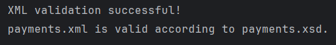
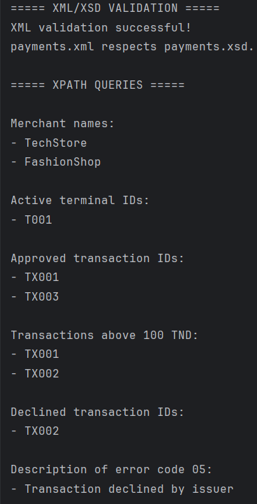
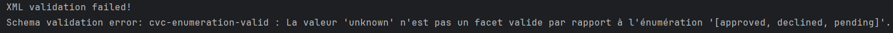

# PayInsight — Smart Payment & Transaction Management System

## 1. Project Overview

**PayInsight** is a Java application developed to demonstrate XML data modeling, XML Schema validation, and XPath queries in the context of a payment management system.

The project represents a simplified payment environment containing customers, merchants, payment terminals, transactions, and payment error codes.

The system uses XML to store the data, XSD to define its structure and constraints, and XPath to retrieve specific information. A Java application combines these features to validate the XML document and execute XPath queries.

This project was developed as part of a practical assignment on XML, XSD, XPath, and Java.

## 2. Project Objectives

The main objectives of this project are:

* Model a real-world domain using XML.
* Organize payment-related information in a structured XML document.
* Define the XML document's structure and constraints using XSD.
* Validate an XML document against its XSD schema.
* Retrieve specific information using XPath expressions.
* Implement XML validation and XPath queries in Java.
* Use Maven to manage the Java project.

## 3. Technologies and Tools

The project uses the following technologies and tools:

* **Java:** Implements XML validation and XPath queries.
* **Maven:** Manages the project configuration and build.
* **XML:** Stores the payment system data.
* **XSD:** Defines the structure and constraints of the XML document.
* **XPath:** Selects and retrieves information from the XML document.
* **JAXP:** Provides Java APIs for XML processing.
* **IntelliJ IDEA:** Development environment.

No additional XML-processing dependency is required because JAXP and XPath are included in the Java platform.

## 4. Project Structure

The project is organized as follows:

```text
payinsight-xml/
├── pom.xml
├── README.md
├── data/
│   ├── payments.xml
│   └── payments.xsd
├── images/
│   ├── validation-success.png
│   ├── xpath-results.png
│   └── validation-error.png
└── src/
    └── main/
        └── java/
            └── com/
                └── payinsight/
                    └── Main.java
```

### File descriptions

| File or folder      | Description                                                |
| ------------------- | ---------------------------------------------------------- |
| `pom.xml`           | Contains the Maven project configuration.                  |
| `README.md`         | Documents the project and explains its implementation.     |
| `data/payments.xml` | Contains the payment system data.                          |
| `data/payments.xsd` | Defines the XML structure and validation rules.            |
| `Main.java`         | Implements XML validation and XPath queries.               |
| `images/`           | Contains screenshots illustrating the application results. |

## 5. XML Data Model

The XML document represents a simplified payment management system.

It contains five main sections.

### 5.1 Customers

The `customers` section stores customer information.

Each customer has:

* A unique identifier.
* A name.

Example: customer C001 is Ahmed Ben Ali.

### 5.2 Merchants

The `merchants` section stores information about businesses accepting payments.

Each merchant has:

* A unique identifier.
* A name.
* A business category.

Example: merchant M001 is TechStore, which belongs to the Electronics category.

### 5.3 Payment Terminals

The `terminals` section represents payment terminals associated with merchants.

Each terminal has:

* A unique identifier.
* A merchant reference.
* A location.
* A status.

Terminal statuses are `active` and `inactive`.

### 5.4 Transactions

The `transactions` section contains payment transaction records.

Each transaction includes:

* A unique transaction identifier.
* A customer reference.
* A merchant reference.
* A terminal reference.
* An amount.
* A currency.
* A transaction date.
* A transaction status.

The permitted transaction statuses are:

* `approved`
* `declined`
* `pending`

The project uses TND as the currency.

### 5.5 Error Codes

The `errorCodes` section contains payment error information.

Each error includes:

* An error code.
* A description.
* A severity level.

The permitted severity levels are `low`, `medium`, and `high`.

These records illustrate how payment-related errors can be organized in an XML document.

## 6. XML Schema Definition (XSD)

The `payments.xsd` file defines the structure and constraints that `payments.xml` must satisfy.

The schema specifies:

* The elements expected in the XML document.
* The order and organization of elements.
* Data types for values such as transaction amounts and dates.
* Required attributes and identifiers.
* Permitted values for terminal statuses, transaction statuses, and error severity.
* References between customers, merchants, terminals, and transactions.

For example, the transaction amount uses the `xs:decimal` data type, while the transaction date uses `xs:date`.

Transaction statuses are restricted to the values `approved`, `declined`, and `pending`.

These constraints help prevent invalid values and incorrect document structures.

## 7. XML Validation with Java

The `Main.java` class validates `payments.xml` against `payments.xsd`.

The validation process follows these steps:

1. Load the XSD schema.
2. Create a validator using the schema.
3. Validate the XML document.
4. Display a success message if validation passes.
5. Display an error message if validation fails.

The application uses the Java `SchemaFactory`, `Schema`, and `Validator` classes to perform validation.

### Successful validation

When the XML document respects the XSD schema, the application displays a successful validation message.

### Invalid XML test

To test the validation mechanism:

1. Open `payments.xml`.
2. Change a transaction status from `approved` to `unknown`.
3. Run `Main.java` again.
4. Verify that validation fails because `unknown` is not an allowed transaction status.
5. Restore the original valid value.

This test demonstrates that the XSD schema enforces the permitted values defined for transactions.

## 8. XPath Queries

XPath is used to select specific nodes and values from the XML document.

The Java application executes the following expressions.

### Query 1: Retrieve all merchant names

**XPath expression:**

```xpath
/paymentSystem/merchants/merchant/name
```

**Purpose:** Retrieves the names of all merchants.

**Expected result:**

* TechStore
* FashionShop

### Query 2: Retrieve active terminal identifiers

**XPath expression:**

```xpath
/paymentSystem/terminals/terminal[status='active']/@id
```

**Purpose:** Selects the identifiers of terminals whose status is `active`.

**Expected result:**

* T001

### Query 3: Retrieve approved transaction identifiers

**XPath expression:**

```xpath
/paymentSystem/transactions/transaction[status='approved']/@id
```

**Purpose:** Selects transactions whose status is `approved`.

**Expected result:**

* TX001
* TX003

### Query 4: Retrieve transactions above 100 TND

**XPath expression:**

```xpath
/paymentSystem/transactions/transaction[amount > 100]/@id
```

**Purpose:** Selects transactions whose amount exceeds 100 TND.

**Expected result:**

* TX001
* TX002

### Query 5: Retrieve declined transaction identifiers

**XPath expression:**

```xpath
/paymentSystem/transactions/transaction[status='declined']/@id
```

**Purpose:** Selects transactions whose status is `declined`.

**Expected result:**

* TX002

### Query 6: Retrieve the description of error code 05

**XPath expression:**

```xpath
/paymentSystem/errorCodes/error[@code='05']/description
```

**Purpose:** Retrieves the description associated with error code `05`.

**Expected result:**

`Transaction declined by issuer`

## 9. Implementation Details

The Java application is divided into methods with specific responsibilities.

| Method                  | Responsibility                                                         |
| ----------------------- | ---------------------------------------------------------------------- |
| `main()`                | Starts the application and coordinates validation and XPath execution. |
| `validateXML()`         | Validates the XML document against the XSD schema.                     |
| `executeXPathQueries()` | Loads the XML document and executes the XPath queries.                 |
| `executeQuery()`        | Evaluates an XPath expression and displays the selected results.       |

The application executes the XPath queries only if XML validation succeeds.

This approach ensures that the queries are applied to a document that conforms to the defined schema.

## 10. How to Run the Project

### Prerequisites

Before running the project, make sure you have:

* A compatible JDK installed.
* IntelliJ IDEA installed.
* Maven configured through IntelliJ IDEA or available on your system.

### Execution steps

1. Open the `payinsight-xml` project in IntelliJ IDEA.
2. Check that the Maven project has loaded correctly.
3. Confirm that `payments.xml` and `payments.xsd` are located in the `data` folder.
4. Open `Main.java`.
5. Run the `main()` method.
6. Examine the console output.

**Important:** The application uses relative file paths, such as `data/payments.xml` and `data/payments.xsd`. Run it with the project root as the working directory.

## 11. Screenshots

The following screenshots illustrate the application's behavior.

### 11.1 Successful XML Validation

This screenshot demonstrates successful validation of the XML document against the XSD schema.



### 11.2 XPath Query Results

This screenshot shows the information retrieved by the XPath expressions, including merchant names, active terminals, and transaction identifiers.



### 11.3 XML Validation Error

This screenshot demonstrates the validation mechanism rejecting an XML document containing an invalid transaction status.



## 12. Conclusion

PayInsight demonstrates how XML, XSD, XPath, and Java can be used together to represent, validate, and query structured data in a payment management system.

The XML document provides an organized representation of customers, merchants, terminals, transactions, and error codes. The XSD schema defines structural and data-type constraints, while XPath enables the retrieval of specific information.

Finally, the Java application combines XML validation and XPath queries into a single execution workflow.

This project provides a practical introduction to XML processing and structured data management in Java.
